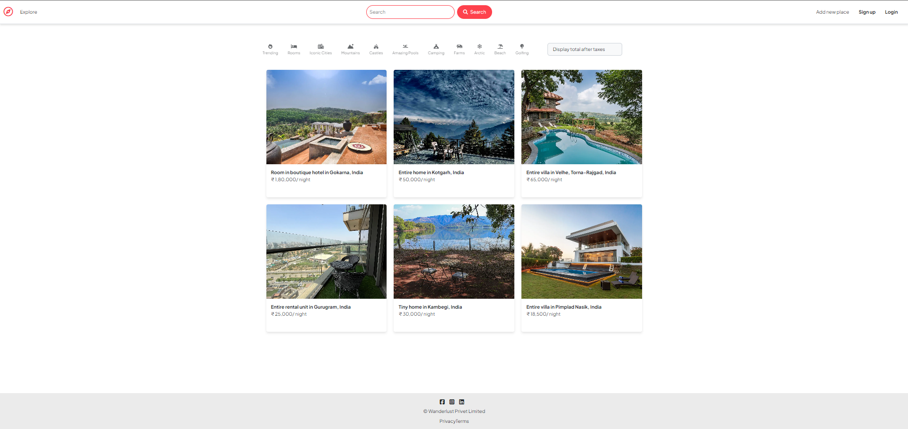
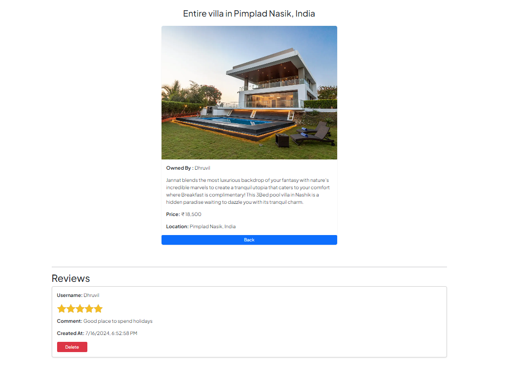

# Wanderlust Project

Wanderlust is a web application that allows users to explore, add, and manage vacation listings. This project was developed as part of my internship, focusing on full-stack development with Node.js, Express, and MongoDB.

## Features

- **User Authentication:** Users can sign up, log in, and manage their accounts.
- **CRUD Operations:** 
  - **Listings:** Users can create, read, update, and delete vacation listings.
  - **Reviews:** Users can add and delete reviews for listings.
- **Responsive Design:** The application is designed to be responsive and user-friendly across various devices.
- **Search Functionality:** Users can search for listings based on location, type, and other criteria.
- **Filtering:** Listings can be filtered by various categories such as trending, rooms, iconic cities, mountains, etc.

## Technologies Used

- **Frontend:**
  - HTML, CSS, JavaScript
  - EJS for templating
  - Bootstrap for responsive design

- **Backend:**
  - Node.js
  - Express.js

- **Database:**
  - MongoDB

- **Other Tools:**
  - Git for version control
  - Render for deployment

## Installation

To run this project locally:

1. Clone the repository:
   
   git clone https://github.com/your-username/wanderlust.git

2. Navigate to the project directory:
 
   cd wanderlust

3. Install dependencies:
   
   npm install

4. Create a `.env` file in the root directory and add your environment variables:
  
   MONGO_URI=your-mongodb-uri
  

5. Run the application:

   npm start
   

6. Open your browser and go to `https://wanderlust-gono.onrender.com/listings/`.

## Usage

- **Sign Up/Login:** Create a new account or log in with your existing credentials.
- **Add a Listing:** Once logged in, users can add new vacation listings.
- **Edit/Delete a Listing:** Users can edit or delete their listings.
- **Add/Delete Reviews:** Users can leave reviews on listings and delete their own reviews.

## Screenshots

### Home Page

### Listing Page
